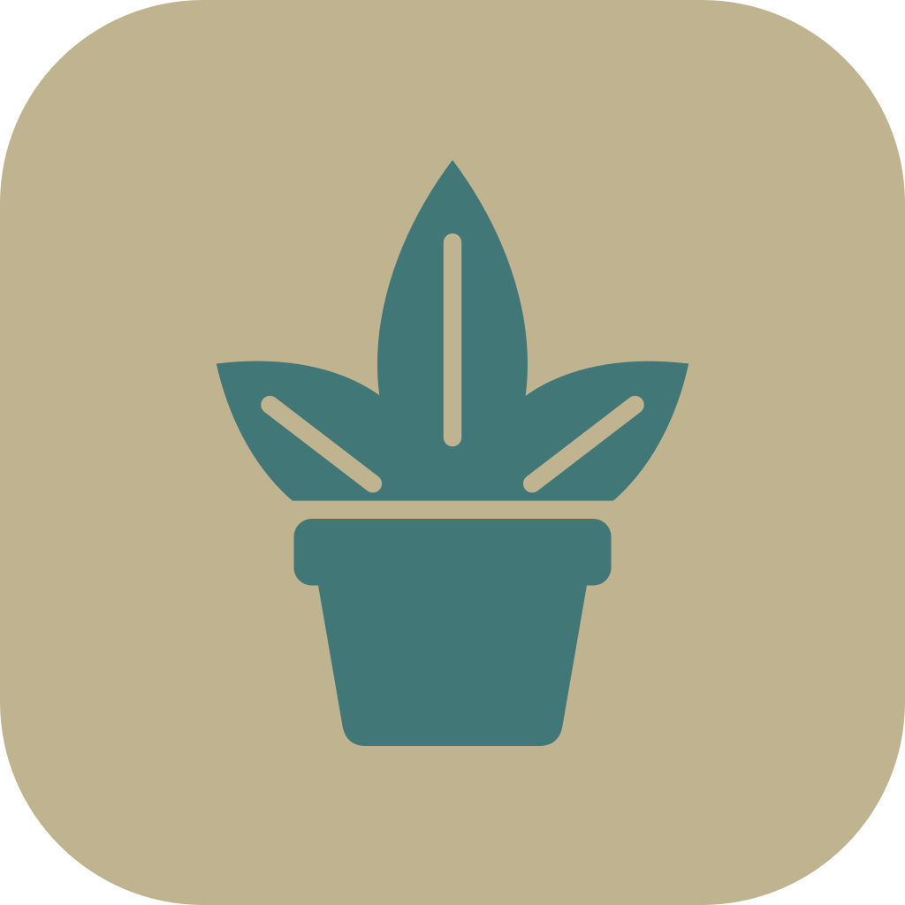
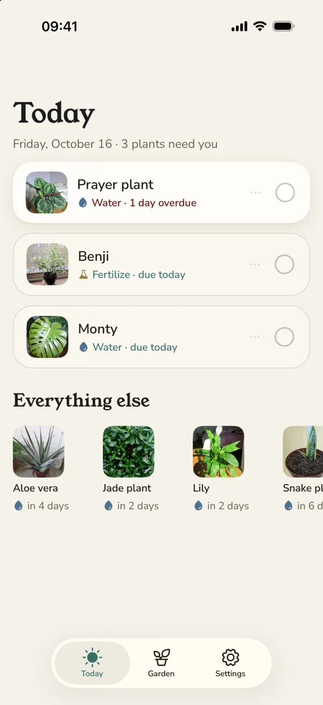
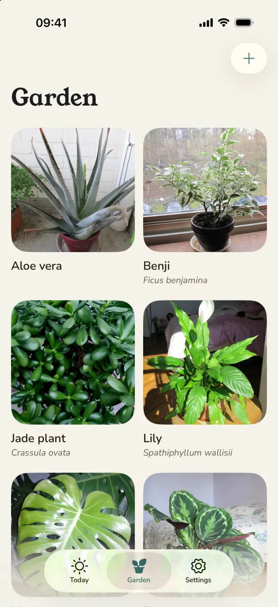
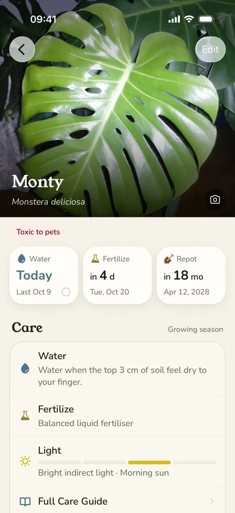
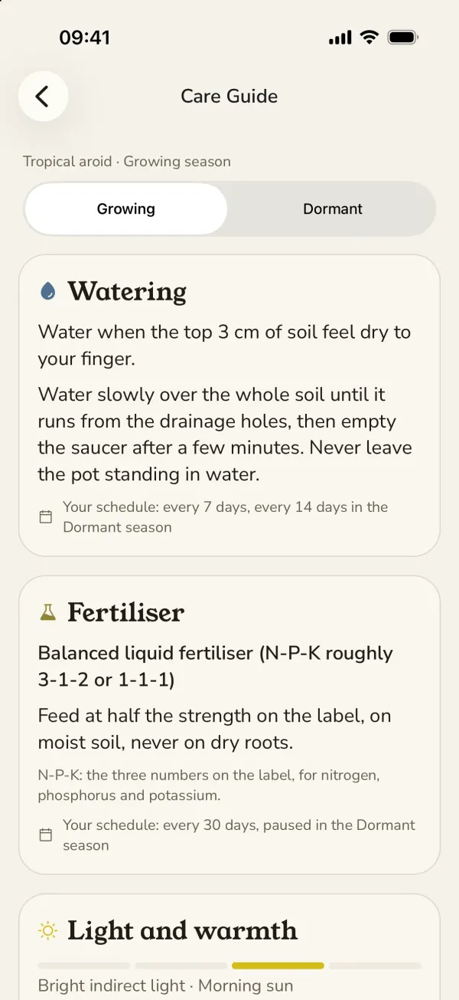
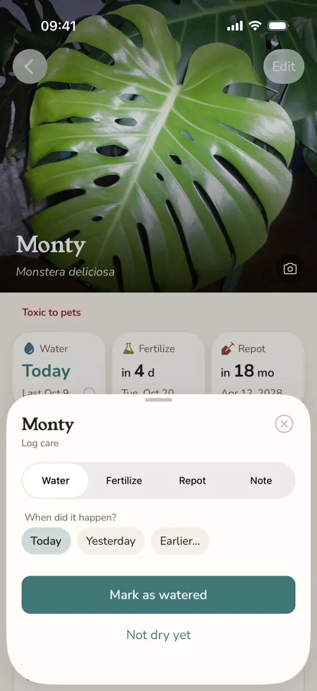

<p align="center">
  
</p>

<h1 align="center">Green Friends</h1>

<p align="center">
  What your houseplants need, and when.<br />
  A local-first iPhone app for houseplant care: watering, fertilizing and repotting schedules, Care Guides, and a Care Log.
</p>

<p align="center">
  <a href="https://apps.apple.com/app/id6823550934"></a>
</p>

<p align="center">
  <a href="https://your-green-friends.com">your-green-friends.com</a> ·
  Free · iPhone with iOS 26 or later · No account, ads or tracking
</p>

<p align="center">
  
  
  <picture>
    <source srcset="web/public/screens/plant-dark-600.webp" media="(prefers-color-scheme: dark)" />
    
  </picture>
  
  
</p>

## What it does

- **Today.** Every day it shows the few plants that need you, and nothing else. One notification a day, the Daily Digest, and only when a plant needs care.
- **A schedule per plant.** Pick the species from a bundled catalog of 458 houseplants and its watering, fertilizing and repotting intervals come with it. Change any interval for one plant, or give a plant a schedule of its own.
- **Seasons.** You set the growing months. Watering and fertilizing slow down or pause for the rest of the year, and summer-resting species turn the season around.
- **Care Guides and Symptoms.** How to water, feed, place and pot each species in the growing and the dormant season. Brown tips, webbing or yellow leaves list the likely causes, how to tell them apart, and what to do.
- **Pet safety.** Toxic or Non-toxic to pets, wherever a published reference such as the ASPCA's lists settles it. Where none does, the app says nothing.
- **Care Log.** Log a watering, a feed, a repot or a note, today or on an earlier day. Soil still damp? *Not dry yet* moves watering on a little.
- **Your data stays on your phone.** Plants, photos and notes live in SQLite on the device and come along in the iPhone backup. Export the whole Garden as one file and Import it on another iPhone.

## Two builds

The App Store build is local-only: it makes no network requests at all, and its App Privacy label is *Data Not Collected*.

The owner's own builds also carry an app token, which turns on three features that go off the phone ([ADR-0012](docs/adr/0012-the-app-store-build-has-no-sync-or-identify.md)):

- **Sync**: an end-to-end encrypted Snapshot of the Garden, uploaded to a small Cloudflare Worker relay ([ADR-0006](docs/adr/0006-sync-phase-1-encrypted-snapshot.md)).
- **Web view**: a read-only view of that Snapshot in the browser, decrypted client-side with the key from a Pairing link.
- **Identify**: a plant photo sent to Pl@ntNet through the relay, on the user's tap only ([ADR-0007](docs/adr/0007-identify-through-plantnet.md)).

## Repository layout

| Path | What's there |
| --- | --- |
| `app/` | expo-router screens: Today, Garden, Settings, the Plant screen and its sheets |
| `src/core/` | The domain in plain TypeScript: care, schedules, seasons, the Daily Digest, Export and Import, Sync. No React or Expo imports |
| `src/db/` | Drizzle schema and the expo-sqlite handle; migrations live in `drizzle/` |
| `src/ui/` | Shared components, theme and words |
| `modules/photo-focus/` | A local Expo module in Swift that finds a photo's focal point with Apple Vision |
| `assets/` | The bundled species catalog and Care Guides, icons |
| `scripts/species/` | Builds the catalog from `curated.json`, Wikidata and GBIF |
| `relay/` | The Cloudflare Worker behind Sync and Identify |
| `web/` | The landing page at `/`, the Web view at `/app/`, and the privacy and support pages |
| `docs/adr/` | Architecture decision records |

The vocabulary (Garden, Plant, Species, Care Log, Due, Season…) is defined in [CONTEXT.md](CONTEXT.md).

## Development

You need macOS with Xcode and Node 24 or later. The app uses native modules (SQLite, notifications, secure store), so it runs as a dev build, not in Expo Go.

```bash
npm install
npm run ios          # dev build on the iOS simulator
npm test             # jest-expo: core tests against in-memory SQLite
npm run lint
npm run typecheck
```

Other commands:

```bash
npm run db:generate     # regenerate drizzle/ after editing src/db/schema.ts
npm run species:build   # rebuild assets/species*.json from scripts/species/curated.json
npm run relay:test      # the relay's vitest suite
npm run web:test        # the Web view's vitest suite
```

`ios/` is generated (Continuous Native Generation), so native settings go in `app.json` and the config plugins under `plugins/`.

More detail:

- [docs/agents/expo.md](docs/agents/expo.md): app code, commands and house rules
- [docs/agents/web.md](docs/agents/web.md): the landing page and Web view
- [docs/agents/relay.md](docs/agents/relay.md): the relay Worker
- [docs/agents/app-store.md](docs/agents/app-store.md): store builds and releases

## Stack

Expo SDK 57 · React Native · expo-router · expo-sqlite + Drizzle · TypeScript · Cloudflare Workers (relay and site) · Vite + sql.js (Web view)
